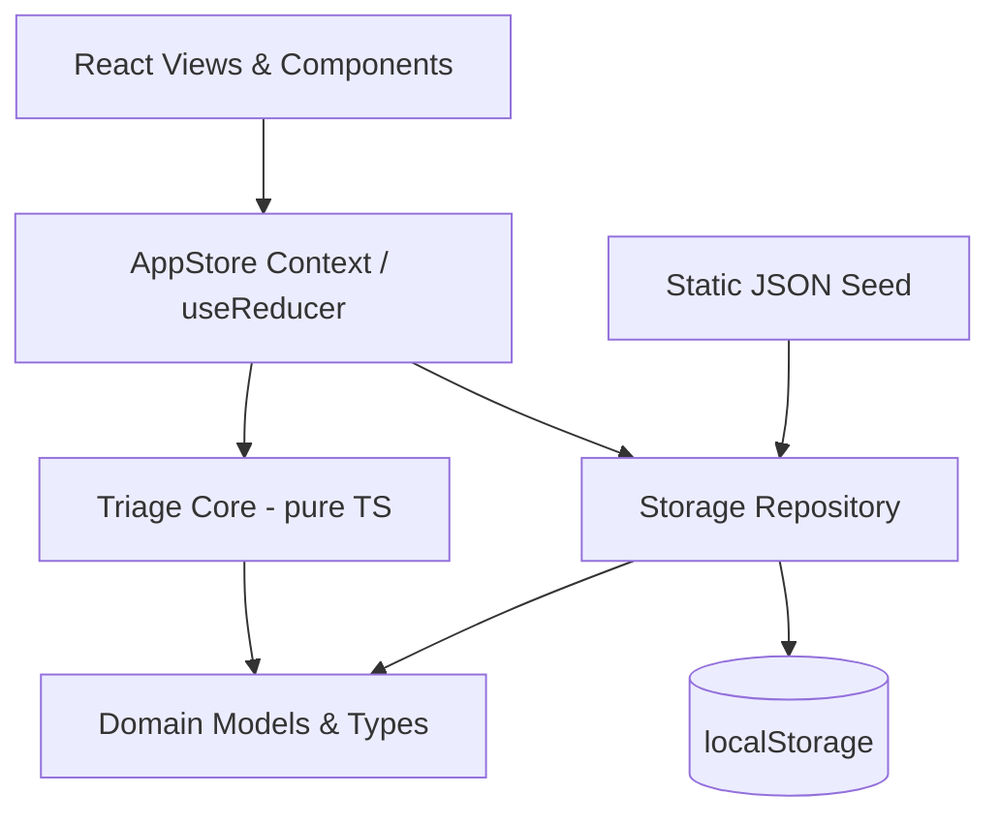
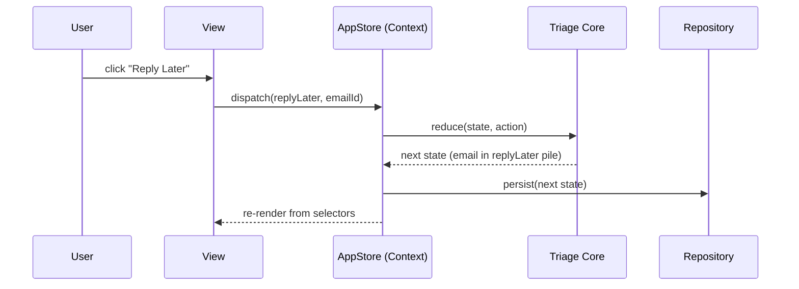
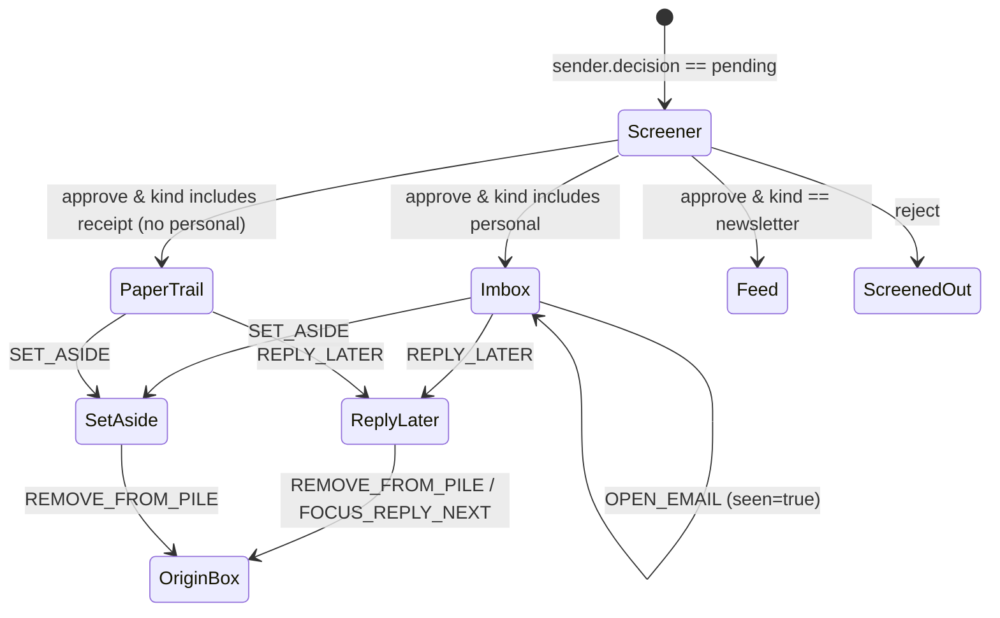

# HEY-style Mail Reader Design

**Spec**: `.specs/features/hey-mail-reader/spec.md`
**Status**: Approved for Execute

---

## Architecture Overview

A React + TypeScript + Vite single-page app over a **pure, framework-agnostic triage
core**. The core owns all mail-triage rules (screening, routing, piles, seen/unseen) as
pure functions over an immutable state value. React consumes the core through a single
Context backed by `useReducer`; a thin repository persists the state to `localStorage`.
All data originates from a bundled static seed.

Layering (dependencies point downward only):



**Key property:** the Triage Core has zero imports from React, the DOM, or storage. It is
a set of `(state, action) -> state` reducers plus selectors, so every spec acceptance
criterion maps to a pure unit test. React and persistence are adapters around it.

### Data flow for one triage action (e.g. "Reply Later")



---

## Code Reuse Analysis

### Existing Components to Leverage

| Component | Location | How to Use |
| --------- | -------- | ---------- |
| None (empty repository) | — | Greenfield; this feature establishes the project baseline |

### Integration Points

| System | Integration Method |
| ------ | ------------------ |
| Browser `localStorage` | Accessed only through the Repository module; never from views/core |
| Static seed JSON | Imported by the Repository as the initial/reset state source |

No existing code to reuse — the project is empty. This design sets the conventions
(pure core + context adapter + repository) that future features follow.

---

## Components

### Domain Models (`src/domain/types.ts`)

- **Purpose**: Canonical TypeScript types for emails, senders, decisions, piles, bundles, and app state.
- **Location**: `src/domain/types.ts`
- **Interfaces**: type definitions only (see Data Models below).
- **Dependencies**: none.
- **Reuses**: none.

### Triage Core (`src/domain/triage.ts`)

- **Purpose**: Pure reducers + selectors implementing all P1 and P2 triage rules from the spec.
- **Location**: `src/domain/triage.ts`
- **Interfaces**:
  - `reduce(state: AppState, action: TriageAction): AppState` — single entry reducer (includes `SET_BUNDLE`)
  - `selectImbox(state): { newForYou: Email[]; previouslySeen: Email[] }`
  - `selectFeed(state): Email[]`
  - `selectPaperTrail(state, query?: string): Email[]` — approved receipt mail newest-first, filtered case-insensitively by sender name, sender address, or subject (`PAPER-01`, `PAPER-02`)
  - `selectDisplayEntries(state, emails: Email[]): DisplayEntry[]` — collapses bundled senders' emails in a given slice into a single expandable bundle entry positioned at the newest email, with emails inside ordered newest-first (`BNDL-01`, `BNDL-02`)
  - `selectScreener(state): Sender[]`
  - `selectPile(state, pile: PileKind): Email[]` — includes approved `imbox`, `feed`, and `paperTrail` emails assigned to `pile`
  - `routeIncoming(state, email): AppState` — applies screening and `personal > receipt > newsletter` classification precedence
  - `selectFocusReply(state): Email | null` — one active reply
  - `normalizeState(input: unknown): NormalizationResult` — validated state plus diagnostics (validates optional boolean `sender.bundled` and repairs `paperTrail` routing)
- **Dependencies**: Domain Models and the pure static seed factory for reset/fallback.
- **Reuses**: none.

### Seed Data (`src/data/seed.ts`)

- **Purpose**: ~40 realistic mock emails across personal/newsletter/receipt senders, some from unknown senders (for The Screener).
- **Location**: `src/data/seed.ts`
- **Interfaces**: `seed: AppState`, `buildSeedState(): AppState`, and
  `buildSeed(): { state: AppState; diagnostics: NormalizationDiagnostic[] }`.
- **Dependencies**: Domain Models and pure content guards.
- **Reuses**: `src/domain/validation.ts` shares record/string/content validation
  with persisted-state normalization, without importing the triage core.
- **Repair clarification (T22)**: Validate each raw bundled message before
  sender dereference or construction. Skip malformed/missing fields and unknown
  sender references, returning identified `malformed-email` diagnostics.
  IDs/timestamps use the original source index, not a filtered-array index.
  State-only helpers remain pure; repository load/reset use `buildSeed()` and
  normalization fallback includes seed diagnostics.
- **P2 clarification**: Approved `receipt` senders (`rail`, `bookshop`) route to `box: 'paperTrail'` and `originBox: 'paperTrail'`. All senders start unbundled (`bundled` omitted / `false`).

### Storage Repository (`src/data/repository.ts`)

- **Purpose**: Load/save `AppState` to `localStorage` with schema-version guarding and seed fallback.
- **Location**: `src/data/repository.ts`
- **Interfaces**:
  - `load(): AppState` — returns persisted state or the seed on miss/invalid/version mismatch
  - `save(state: AppState): void`
  - `reset(): AppState` — restore the seed
  - `getNotices(): readonly RepositoryNotice[]` and `subscribe(listener)` — observable session diagnostics, including failed writes
  - `createRepository(getStorage?)` — isolated session; exported `repository` is the browser singleton
- **Dependencies**: Seed Data, Domain Models, core normalization.
- **Reuses**: none.
- **Execution clarification (T10)**: The repository retains all core diagnostics,
  logs each as `console.warn(message, notice)`, and publishes immutable-by-contract
  notice snapshots. JSON failures add `seed-restored` / `invalid-json`; storage
  failures add `storage-unavailable` with `operation: load | save | reset`.
  Load is cached per session; storage key is `missiva.mailbox.v1`. A storage
  failure disables persistence for that instance. Initial load failure uses seed;
  later failed saves preserve the latest triage in memory, not a destructive
  mid-session reset. Reset persists a fresh seed without clearing unrelated keys.
  Missing keys with a healthy seed are silent; bundled skip diagnostics remain
  observable on first load, all fallback paths, and reset, just like persisted
  data diagnostics.

### AppStore (`src/state/AppStore.tsx`)

- **Purpose**: React Context exposing current state + `dispatch`, wiring the core to persistence.
- **Location**: `src/state/AppStore.tsx`
- **Interfaces**:
  - `<AppStoreProvider>` — initializes from `repository.load()`, persists on each change
  - `useAppState()` / `useDispatch()` hooks
  - `useAppNotices()` — current repository diagnostics for the future banner
- **Dependencies**: Triage Core, Repository.
- **Reuses**: none.
- **Execution clarification (T11)**: Provider accepts an optional stable
  `repository` prop for isolated tests. `useReducer` loads initial state; an
  effect saves on mount and state changes.
  `useSyncExternalStore` retains startup notices and observes failed saves
  without coupling UI to browser storage. Provider/hook exports share one
  public entry point, with a scoped Fast Refresh export-rule exception.
- **Repair clarification (T22)**: The store intercepts `RESET_SEED` at the event
  boundary and calls `repository.reset()` outside any reducer, preserving seed
  skip diagnostics. A pure internal `RESTORE_SEED` action installs its returned
  state; the ordinary save effect also observes that state. All other actions
  use the unchanged pure triage reducer. Direct core `RESET_SEED` remains pure
  and returns validated state. Views still only dispatch.

### HTML Sanitizer (`src/lib/sanitize.ts`)

- **Purpose**: Sanitize mock email HTML bodies before rendering (XSS guard, spec edge case).
- **Location**: `src/lib/sanitize.ts`
- **Interfaces**: `sanitizeHtml(raw: string): string`.
- **Dependencies**: `dompurify`.
- **Reuses**: none.
- **Execution clarification (T12)**: `DOMPurify.sanitize(raw,
  { USE_PROFILES: { html: true } })` is the shared browser render seam.
  Safe HTML, links, and remote images remain; executable links/handlers/scripts
  and non-HTML namespaces do not. T14/T19 must use the helper before rendering,
  without subsequently appending unsanitized markup. DOMPurify's official
  README documents this import/profile and the post-sanitization mutation caveat.

### App Shell & Routing (`src/app/`)

- **Purpose**: Layout shell (sidebar nav, main pane, bottom-docked piles) + client routes.
- **Location**: `src/app/AppShell.tsx`
- **Interfaces**: route table for `/imbox`, `/feed`, `/paper-trail`, `/screener`, `/reply-later`, `/set-aside`.
- **Dependencies**: `react-router-dom`, AppStore, feature views.
- **Reuses**: none.

### Feature Views (`src/features/*`)

- **Purpose**: One view per P1/P2 surface, each reading selectors and dispatching actions.
- **Location**:
  - `src/features/imbox/ImboxView.tsx` (New/Seen groups, bundle rows + email rows, open-to-seen)
  - `src/features/paper-trail/PaperTrailView.tsx` (receipts list, search by sender/subject, bundle rows + email rows, reader)
  - `src/features/screener/ScreenerView.tsx` (Yes/No decisions)
  - `src/features/reply-later/ReplyLater.tsx` (pile + Focus & Reply stepper)
  - `src/features/set-aside/SetAside.tsx`
  - `src/features/feed/FeedView.tsx`
  - `src/features/common/` (`EmailRow`, `BundleRow`, `EmailList`, `MailActions`, `ReturnToBox`, `EmptyState`, `PileDock`, `useShortcuts`)
- **Dependencies**: AppStore selectors/actions, Sanitizer.
- **Reuses**: shared common components.

### Keyboard Shortcuts (`src/features/common/useShortcuts.ts`)

- **Purpose**: Bind `j/k/e/r/y/n` to selection and triage actions.
- **Location**: `src/features/common/useShortcuts.ts`
- **Interfaces**: `useShortcuts(handlers)`, `useMailShortcuts(emails, openedId, onClose)`.
- **Dependencies**: AppStore dispatch.
- **Reuses**: none.

---

## Data Models

**Execution clarifications (T2 & P2)**:
- SPEC_DEVIATION: `Sender.kind` accepts one kind or an array of kinds. The spec's
  multi-classification edge cannot be represented by the original single literal.
  Precedence is `personal > receipt > newsletter` (`imbox` > `paperTrail` > `feed`).
- SPEC_DEVIATION: `BoxKind` includes `screener`; pending mail needs a real location
  distinct from rejected mail.
- P2 update (supersedes T2's P1-only receipt note): approved `receipt` senders
  without `personal` now route to `paperTrail` (`PAPER-01`). `Sender` adds
  optional `bundled?: boolean` (`BNDL-01`), defaulting to `false` when omitted.
- Focus & Reply processes remaining replies newest-first, matching the pile list.
  Finishing clears `pile`, marks the email seen, and restores `originBox`.
  SPEC_DEVIATION: cursor stays at `0` after a finished item is removed from the
  queue, instead of incrementing into a shrinking list and skipping an email.
  `selectFocusReply(state)` exposes exactly the active email or `null`.
  Explicit exit leaves the remaining pile intact.
- `normalizeState` returns `{state, restoredSeed, diagnostics}`. It restores
  invalid envelopes/unknown versions, skips malformed records, and explicitly
  signals repairs to order/routing/focus. Valid empty mailboxes remain empty.
  SPEC_DEVIATION: warnings are returned as structured diagnostics, not logged by
  the core. T10/T11 adapters must log malformed-record warnings and retain notices
  for T20's non-blocking banner. This preserves AD-001's pure core.
  Missing storage keys are not corruption; adapters use a fresh validated seed
  and report any bundled skip diagnostics without adding a corruption notice.

```typescript
type SenderId = string
type EmailId = string

type SenderDecision = 'pending' | 'approved' | 'rejected'
type SenderKind = 'personal' | 'newsletter' | 'receipt'

interface Sender {
  id: SenderId
  name: string
  address: string
  kind: SenderKind | SenderKind[]
  decision: SenderDecision
  bundled?: boolean
}

type BoxKind = 'imbox' | 'feed' | 'screener' | 'paperTrail' | 'screenedOut'
type PileKind = 'replyLater' | 'setAside'

type DisplayEntry =
  | { kind: 'email'; email: Email; sender: Sender }
  | { kind: 'bundle'; sender: Sender; emails: Email[]; latest: Email }

interface Email {
  id: EmailId
  senderId: SenderId
  subject: string
  snippet: string
  bodyHtml: string
  receivedAt: string        // ISO timestamp
  seen: boolean
  box: BoxKind              // resolved box after routing
  pile: PileKind | null     // overrides box docking when set
  originBox: BoxKind        // where it returns to when removed from a pile
}

interface AppState {
  schemaVersion: number
  senders: Record<SenderId, Sender>
  emails: Record<EmailId, Email>
  order: EmailId[]          // global receive order, newest last
  focusReply: { active: boolean; cursor: number }
}

type TriageAction =
  | { type: 'OPEN_EMAIL'; emailId: EmailId }
  | { type: 'SCREEN_DECIDE'; senderId: SenderId; decision: 'approved' | 'rejected' }
  | { type: 'REPLY_LATER'; emailId: EmailId }
  | { type: 'SET_ASIDE'; emailId: EmailId }
  | { type: 'REMOVE_FROM_PILE'; emailId: EmailId }
  | { type: 'SET_BUNDLE'; senderId: SenderId; bundled: boolean }
  | { type: 'FOCUS_REPLY_START' }
  | { type: 'FOCUS_REPLY_NEXT' }
  | { type: 'FOCUS_REPLY_EXIT' }
  | { type: 'RESET_SEED' }
```

**Relationships**: `Email.senderId → Sender.id`. A sender's `decision` gates whether its
emails appear in active boxes (SCRN-01..04). `kind` drives routing to `imbox` vs `paperTrail`
vs `feed` (`personal > receipt > newsletter`; FEED-01, PAPER-01). `sender.bundled` collapses
that sender's emails within each Imbox group and in Paper Trail into a single expandable
`DisplayEntry` whose inner `emails` are ordered newest-first (BNDL-01, BNDL-02). `pile`
dominates box docking for the bottom piles; `originBox` restores placement on removal (ASIDE-03).

---

## Triage State Machine (routing rules)



Conflict rule (spec edge case): applying `REPLY_LATER` to an email already in `setAside`
(or vice-versa) moves it to the newly chosen pile only — `pile` holds a single value.

---

## Error Handling Strategy

| Error Scenario | Handling | User Impact |
| -------------- | -------- | ----------- |
| Stored state has unknown `schemaVersion` (IMBOX-05) | Repository discards it, returns seed | Non-blocking banner: "Restored sample mailbox" |
| Malformed/missing email field or unknown sender in seed | Pure loader skips before construction and returns diagnostics; repository logs/publishes them on load/fallback/reset | Bad email absent, healthy IDs stable, nonblocking notice; app keeps running |
| Unsafe HTML in body | `sanitizeHtml` strips scripts/handlers before render | Clean body shown |
| `localStorage` unavailable/full | Repository catches, runs in-memory from seed | Banner: "Changes won't be saved this session" |
| Sender classified as both newsletter and personal | Routing defaults to `personal` → Imbox | Email appears in Imbox |

---

## Risks & Concerns

| Concern | Location (file:line) | Impact | Mitigation |
| ------- | -------------------- | ------ | ---------- |
| XSS via rendered mock HTML bodies | `src/features/*` render path | Script injection if raw HTML is dangerouslySet | Mandatory `sanitizeHtml` (DOMPurify) at the single render seam; unit-tested against a script payload |
| `localStorage` quota/availability failures | `src/data/repository.ts` | Unhandled throw would blank the app | try/catch with in-memory fallback + banner; covered by a test |
| Seed/state schema drift over time | `src/data/repository.ts` | Stale persisted state breaks UI | `schemaVersion` guard with seed fallback (IMBOX-05) |
| Triage rules leaking into React components | `src/features/*` | Untestable logic, UI/logic coupling | All rules confined to pure core; views only dispatch/select — enforced by review |

> No pre-existing code concerns — greenfield repository.

---

## Tech Decisions (only non-obvious ones)

| Decision | Choice | Rationale |
| -------- | ------ | --------- |
| State management | Pure core + Context/`useReducer` | Zero deps; maximal unit-testability for the Verifier's spec-anchored tests |
| Routing | `react-router-dom` | Deep-linkable boxes aid demo and per-story independent tests |
| HTML sanitization | `dompurify` | Battle-tested XSS prevention; safer than hand-rolled |
| Test stack | Vitest + React Testing Library + jsdom | Vite-native, fast; RTL for view behavior, Vitest for pure core |
| Styling | CSS Modules (hand-rolled) | Matches HEY's custom look without fighting a UI kit (confirmed assumption) |

> **Project-level decisions** recorded in `.specs/STATE.md` `## Decisions` as `AD-001`..`AD-004`.

---

## Tips / Notes

- Each P1 story maps to its own view + a slice of the core, so every story is independently demoable and testable per the spec's Independent Test lines.
- The pure core is the test surface: screening (SCRN), routing (FEED/IMBOX), piles (REPLY/ASIDE), and seen transitions are all `(state, action) -> state` assertions.
- **P3 Extensions**:
  - **Bubble Up (`BUBBLE-01`)**: `Email.bubbledUntil?: string | null` stores the future ISO timestamp. `BUBBLE_UP` hides the email from `selectImbox`, `selectFeed`, `selectPaperTrail`, and `selectPile` while `selectBubbledUp(state)` returns bubbled emails sorted by `bubbledUntil` ascending. `BUBBLE_RELEASE` (triggered by the demo clock action in `ImboxView`) clears `bubbledUntil`, marks the email `seen: false`, `box: 'imbox'`, updates `receivedAt` to `action.now`, and moves its ID to the end of `state.order` so it returns to the top of `New for you`.
  - **Read Together (`READ-01`)**: `EmailRow` and `EmailList` accept optional multi-select props (`selectedIds`, `onToggleSelect`). `ImboxView` renders a `Read Together` bar when emails are checked, opening `ReadTogetherReader` which stacks the selected emails in a single scrollable container (`role="region"`, `aria-label="Read Together"`) and marks them seen.
  - **Spy-pixel Blocker (`SPY-01`)**: `detectTrackingPixels(raw)` in `src/lib/sanitize.ts` counts `` elements with `1x1` dimensions, `data-spy-pixel`, or known tracker URL patterns (`pixel.`, `/open.gif`, `/track`, `/beacon`, `spy-pixel`), and `sanitizeHtml(raw)` strips those `` elements before rendering. `EmailRow`, `MailReader`, and `FeedView` surface a `Tracker flagged` / `Spy pixel blocked` badge when tracking pixels are detected on the email or sender.

