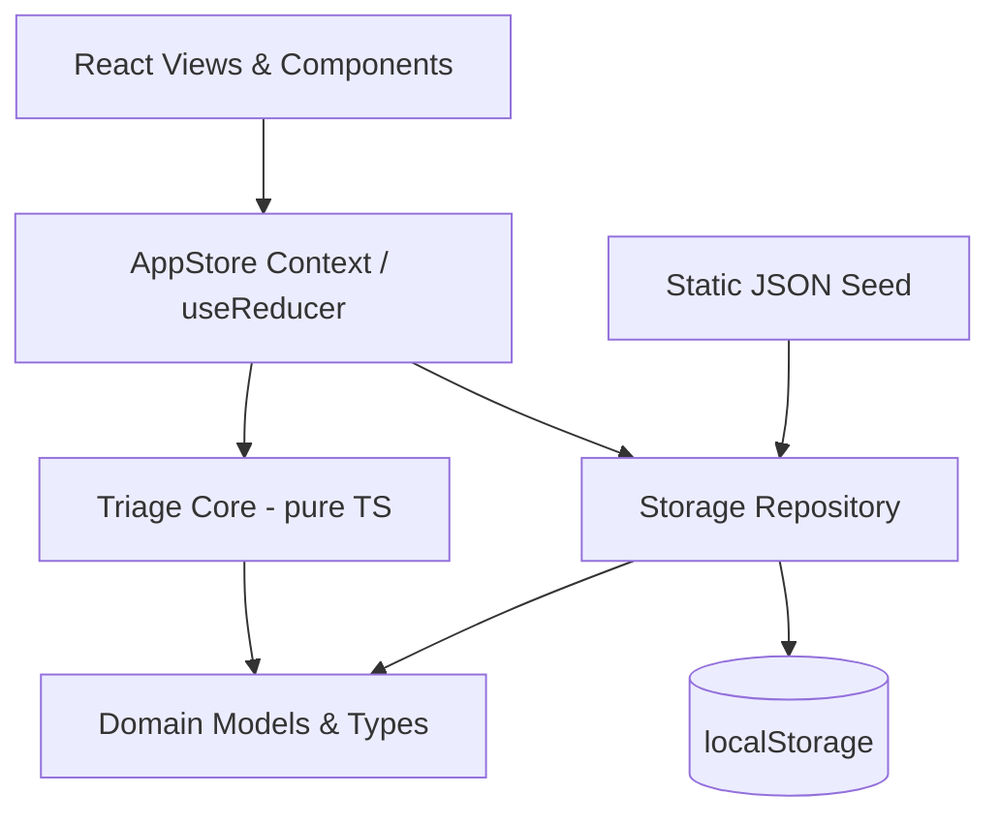
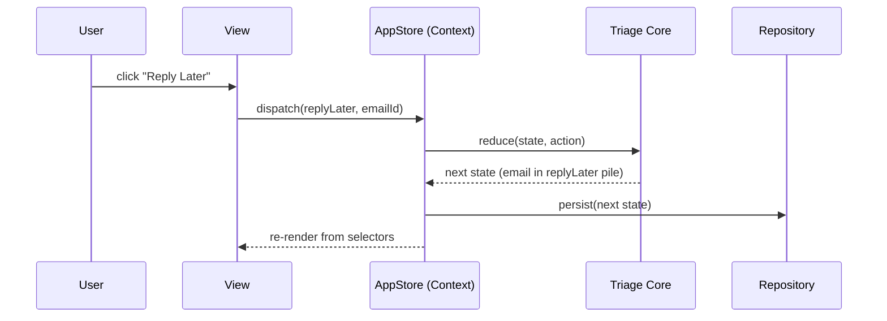
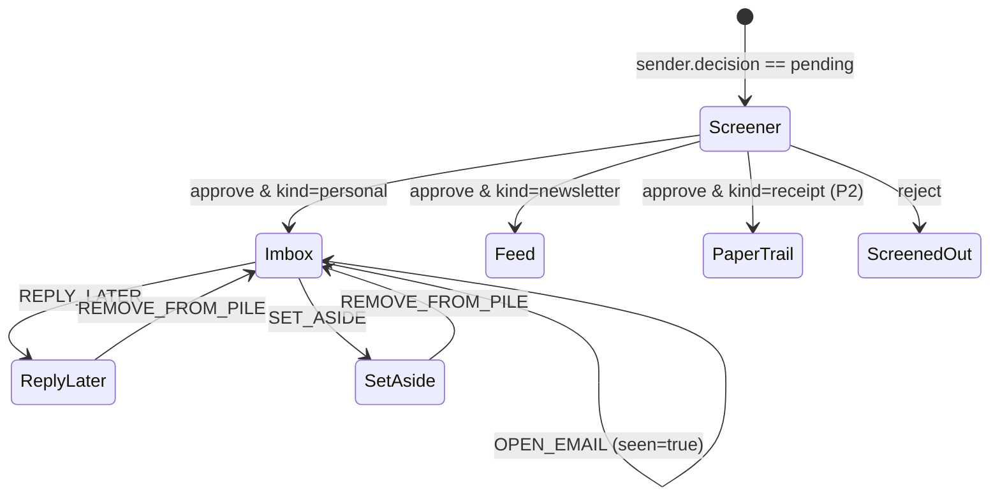

# HEY-style Mail Reader Design

**Spec**: `.specs/features/hey-mail-reader/spec.md`
**Status**: Approved for Execute

---

## Architecture Overview

A React + TypeScript + Vite single-page app over a **pure, framework-agnostic triage
core**. The core owns all mail-triage rules (screening, routing, piles, seen/unseen) as
pure functions over an immutable state value. React consumes the core through a single
Context backed by `useReducer`; a thin repository persists the state to `localStorage`.
All data originates from a bundled static seed.

Layering (dependencies point downward only):



**Key property:** the Triage Core has zero imports from React, the DOM, or storage. It is
a set of `(state, action) -> state` reducers plus selectors, so every spec acceptance
criterion maps to a pure unit test. React and persistence are adapters around it.

### Data flow for one triage action (e.g. "Reply Later")



---

## Code Reuse Analysis

### Existing Components to Leverage

| Component | Location | How to Use |
| --------- | -------- | ---------- |
| None (empty repository) | — | Greenfield; this feature establishes the project baseline |

### Integration Points

| System | Integration Method |
| ------ | ------------------ |
| Browser `localStorage` | Accessed only through the Repository module; never from views/core |
| Static seed JSON | Imported by the Repository as the initial/reset state source |

No existing code to reuse — the project is empty. This design sets the conventions
(pure core + context adapter + repository) that future features follow.

---

## Components

### Domain Models (`src/domain/types.ts`)

- **Purpose**: Canonical TypeScript types for emails, senders, decisions, piles, and app state.
- **Location**: `src/domain/types.ts`
- **Interfaces**: type definitions only (see Data Models below).
- **Dependencies**: none.
- **Reuses**: none.

### Triage Core (`src/domain/triage.ts`)

- **Purpose**: Pure reducers + selectors implementing all triage rules from the spec.
- **Location**: `src/domain/triage.ts`
- **Interfaces**:
  - `reduce(state: AppState, action: TriageAction): AppState` — single entry reducer
  - `selectImbox(state): { newForYou: Email[]; previouslySeen: Email[] }`
  - `selectFeed(state): Email[]`
  - `selectScreener(state): Sender[]`
  - `selectPile(state, pile: PileKind): Email[]`
  - `routeIncoming(state, email): AppState` — applies screening/classification rules
- **Dependencies**: Domain Models.
- **Reuses**: none.

### Seed Data (`src/data/seed.ts`)

- **Purpose**: ~40 realistic mock emails across personal/newsletter/receipt senders, some from unknown senders (for The Screener).
- **Location**: `src/data/seed.ts`
- **Interfaces**: `export const seed: AppState` (or a `buildSeedState()` factory).
- **Dependencies**: Domain Models.
- **Reuses**: none.

### Storage Repository (`src/data/repository.ts`)

- **Purpose**: Load/save `AppState` to `localStorage` with schema-version guarding and seed fallback.
- **Location**: `src/data/repository.ts`
- **Interfaces**:
  - `load(): AppState` — returns persisted state or the seed on miss/invalid/version mismatch
  - `save(state: AppState): void`
  - `reset(): AppState` — restore the seed
- **Dependencies**: Seed Data, Domain Models.
- **Reuses**: none.

### AppStore (`src/state/AppStore.tsx`)

- **Purpose**: React Context exposing current state + `dispatch`, wiring the core to persistence.
- **Location**: `src/state/AppStore.tsx`
- **Interfaces**:
  - `<AppStoreProvider>` — initializes from `repository.load()`, persists on each change
  - `useAppState()` / `useDispatch()` hooks
- **Dependencies**: Triage Core, Repository.
- **Reuses**: none.

### HTML Sanitizer (`src/lib/sanitize.ts`)

- **Purpose**: Sanitize mock email HTML bodies before rendering (XSS guard, spec edge case).
- **Location**: `src/lib/sanitize.ts`
- **Interfaces**: `sanitizeHtml(raw: string): string`.
- **Dependencies**: `dompurify`.
- **Reuses**: none.

### App Shell & Routing (`src/app/`)

- **Purpose**: Layout shell (sidebar nav, main pane, bottom-docked piles) + client routes.
- **Location**: `src/app/AppShell.tsx`, `src/app/routes.tsx`
- **Interfaces**: route table for `/imbox`, `/feed`, `/screener`, `/reply-later`, `/set-aside`.
- **Dependencies**: `react-router-dom`, AppStore, feature views.
- **Reuses**: none.

### Feature Views (`src/features/*`)

- **Purpose**: One view per P1 surface, each reading selectors and dispatching actions.
- **Location**:
  - `src/features/imbox/ImboxView.tsx` (New/Seen groups, email rows, open-to-seen)
  - `src/features/screener/ScreenerView.tsx` (Yes/No decisions)
  - `src/features/reply-later/ReplyLaterPile.tsx` + `FocusReplyMode.tsx`
  - `src/features/set-aside/SetAsidePile.tsx`
  - `src/features/feed/FeedView.tsx`
  - `src/features/common/` (EmailRow, EmptyState, PileDock, Shortcuts)
- **Dependencies**: AppStore selectors/actions, Sanitizer.
- **Reuses**: shared common components.

### Keyboard Shortcuts (`src/features/common/useShortcuts.ts`)

- **Purpose**: Bind `j/k/e/r/y/n` to selection and triage actions.
- **Location**: `src/features/common/useShortcuts.ts`
- **Interfaces**: `useShortcuts(handlers)`.
- **Dependencies**: AppStore dispatch.
- **Reuses**: none.

---

## Data Models

**Execution clarifications (T2)**:
- SPEC_DEVIATION: `Sender.kind` accepts one kind or an array of kinds. The spec's
  dual-classification edge cannot be represented by the original single literal.
  Personal wins over newsletter.
- SPEC_DEVIATION: `BoxKind` includes `screener`; pending mail needs a real location
  distinct from rejected mail.
- SPEC_DEVIATION: approved receipts use Imbox in P1. `paperTrail` remains a
  reserved type, not an implemented route. This avoids hiding demo receipts behind
  a deferred P2 UI and follows P1's approved-sender Imbox/newsletter Feed rule.
- Focus & Reply processes remaining replies newest-first, matching the pile list.
  Finishing clears `pile`, marks the email seen, and restores `originBox`.
  SPEC_DEVIATION: cursor stays at `0` after a finished item is removed from the
  queue, instead of incrementing into a shrinking list and skipping an email.
  `selectFocusReply(state)` exposes exactly the active email or `null`.
  Explicit exit leaves the remaining pile intact.

```typescript
type SenderId = string
type EmailId = string

type SenderDecision = 'pending' | 'approved' | 'rejected'
type SenderKind = 'personal' | 'newsletter' | 'receipt'

interface Sender {
  id: SenderId
  name: string
  address: string
  kind: SenderKind
  decision: SenderDecision
}

type BoxKind = 'imbox' | 'feed' | 'paperTrail' | 'screenedOut'
type PileKind = 'replyLater' | 'setAside'

interface Email {
  id: EmailId
  senderId: SenderId
  subject: string
  snippet: string
  bodyHtml: string
  receivedAt: string        // ISO timestamp
  seen: boolean
  box: BoxKind              // resolved box after routing
  pile: PileKind | null     // overrides box docking when set
  originBox: BoxKind        // where it returns to when removed from a pile
}

interface AppState {
  schemaVersion: number
  senders: Record<SenderId, Sender>
  emails: Record<EmailId, Email>
  order: EmailId[]          // global receive order, newest last
  focusReply: { active: boolean; cursor: number }
}

type TriageAction =
  | { type: 'OPEN_EMAIL'; emailId: EmailId }
  | { type: 'SCREEN_DECIDE'; senderId: SenderId; decision: 'approved' | 'rejected' }
  | { type: 'REPLY_LATER'; emailId: EmailId }
  | { type: 'SET_ASIDE'; emailId: EmailId }
  | { type: 'REMOVE_FROM_PILE'; emailId: EmailId }
  | { type: 'FOCUS_REPLY_START' }
  | { type: 'FOCUS_REPLY_NEXT' }
  | { type: 'FOCUS_REPLY_EXIT' }
  | { type: 'RESET_SEED' }
```

**Relationships**: `Email.senderId → Sender.id`. A sender's `decision` gates whether its
emails appear in active boxes (SCRN-01..04). `kind` drives routing to `imbox` vs `feed`
vs `paperTrail` (FEED-01, and P2 PAPER-01). `pile` dominates box docking for the
bottom piles; `originBox` restores placement on removal (ASIDE-03).

---

## Triage State Machine (routing rules)



Conflict rule (spec edge case): applying `REPLY_LATER` to an email already in `setAside`
(or vice-versa) moves it to the newly chosen pile only — `pile` holds a single value.

---

## Error Handling Strategy

| Error Scenario | Handling | User Impact |
| -------------- | -------- | ----------- |
| Stored state has unknown `schemaVersion` (IMBOX-05) | Repository discards it, returns seed | Non-blocking banner: "Restored sample mailbox" |
| Malformed/missing email field in seed | Core/loader skips the email, logs a console warning | Email absent; app keeps running |
| Unsafe HTML in body | `sanitizeHtml` strips scripts/handlers before render | Clean body shown |
| `localStorage` unavailable/full | Repository catches, runs in-memory from seed | Banner: "Changes won't be saved this session" |
| Sender classified as both newsletter and personal | Routing defaults to `personal` → Imbox | Email appears in Imbox |

---

## Risks & Concerns

| Concern | Location (file:line) | Impact | Mitigation |
| ------- | -------------------- | ------ | ---------- |
| XSS via rendered mock HTML bodies | `src/features/*` render path | Script injection if raw HTML is dangerouslySet | Mandatory `sanitizeHtml` (DOMPurify) at the single render seam; unit-tested against a script payload |
| `localStorage` quota/availability failures | `src/data/repository.ts` | Unhandled throw would blank the app | try/catch with in-memory fallback + banner; covered by a test |
| Seed/state schema drift over time | `src/data/repository.ts` | Stale persisted state breaks UI | `schemaVersion` guard with seed fallback (IMBOX-05) |
| Triage rules leaking into React components | `src/features/*` | Untestable logic, UI/logic coupling | All rules confined to pure core; views only dispatch/select — enforced by review |

> No pre-existing code concerns — greenfield repository.

---

## Tech Decisions (only non-obvious ones)

| Decision | Choice | Rationale |
| -------- | ------ | --------- |
| State management | Pure core + Context/`useReducer` | Zero deps; maximal unit-testability for the Verifier's spec-anchored tests |
| Routing | `react-router-dom` | Deep-linkable boxes aid demo and per-story independent tests |
| HTML sanitization | `dompurify` | Battle-tested XSS prevention; safer than hand-rolled |
| Test stack | Vitest + React Testing Library + jsdom | Vite-native, fast; RTL for view behavior, Vitest for pure core |
| Styling | CSS Modules (hand-rolled) | Matches HEY's custom look without fighting a UI kit (confirmed assumption) |

> **Project-level decisions** recorded in `.specs/STATE.md` `## Decisions` as `AD-001`..`AD-004`.

---

## Tips / Notes

- Each P1 story maps to its own view + a slice of the core, so every story is independently demoable and testable per the spec's Independent Test lines.
- The pure core is the test surface: screening (SCRN), routing (FEED/IMBOX), piles (REPLY/ASIDE), and seen transitions are all `(state, action) -> state` assertions.
